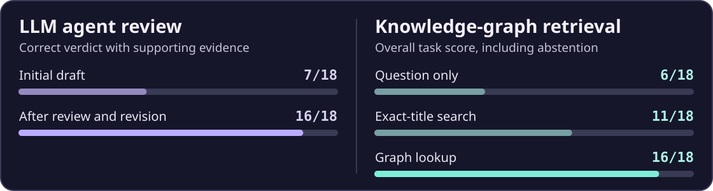

I’m a final-year computer science student at **FINKI** and a machine learning research intern at the **Macedonian Academy of Sciences and Arts**. I build benchmarks to see when LLMs get an answer right, whether the evidence supports it, and where the system fails. I enjoy testing how LLMs and agents behave in everyday use, too.

[LinkedIn](https://www.linkedin.com/in/tomi-bogoeski/) · [CIIT 2026 paper](https://github.com/Tomi-Beep/llm-hamiltonian-tsp-verification/blob/main/paper.pdf)

## LLM evaluation

| Project | What I tested |
| :-- | :-- |
| [LLM agentic verification for Macedonian claims](https://github.com/Tomi-Beep/llm-agents-macedonian-claim-verification) | On 18 census claims, correct verdicts with supporting evidence rose from **7/18 to 16/18** after review and revision. |
| [Knowledge-graph retrieval for Macedonian media](https://github.com/Tomi-Beep/llm-kg-macedonian-media-eval) | On 18 film-music questions, graph lookup scored **16/18**, compared with **11/18** for exact-title search and **6/18** with the question alone. |

## More selected work

- **[Verifying LLM-generated solvers](https://github.com/Tomi-Beep/llm-hamiltonian-tsp-verification)** · Co-authored a CIIT 2026 paper using exact algorithms to check LLM-generated solvers for Hamiltonian Cycle and Traveling Salesman.
- **[GitHub Explorer](https://github.com/Tomi-Beep/github-explorer)** · Built a Spring Boot application that searches GitHub’s REST API and saves repositories to a personal watchlist.
